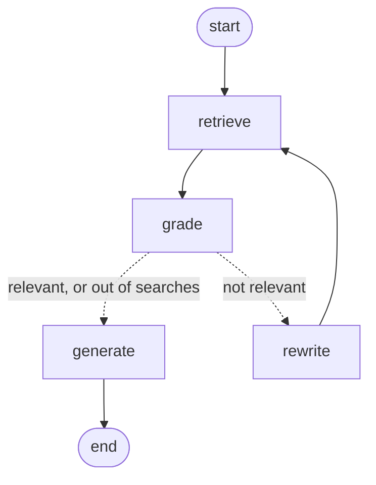

# Doc 4: LangGraph agent and its evaluation

**Time:** ~1.5 hours  **You build:** a self-correcting RAG agent, wired step by step with LangGraph, and a one-to-one comparison with plain RAG from Doc 1.

**Files you create in this doc:**

| Folder | Files | Step |
|---|---|---|
| `app/langgraph_agent/` | `nodes.py`, `graph.py` | 2 |
| `eval/langgraph_agent/` | `evaluate.py` | 3.2 |

Plus an `__init__.py` in each new folder. The agent reuses the RAG search and prompt from Doc 1 (`app/rag/query.py`); the eval reuses the RAG eval (`eval/rag/`).

---

## 1. Why LangGraph?

In Docs 2 and 3, `create_agent` built the loop for you, and **the LLM decided every step**: which tool, how often, when to stop. That's flexible, but hard to predict.

Under the hood, `create_agent` is a **LangGraph graph**. LangGraph lets you build such a graph yourself, so that **you decide the flow** and the LLM only answers small questions inside it. Companies often prefer this for fixed workflows, because it is predictable and easy to test.

| Word | Plain meaning |
|---|---|
| **State** | One dict that every step can read, e.g. `{question, query, chunks, answer}`. It flows through the graph. |
| **Node** | One step: a plain Python function. It gets the state and returns only the keys it changes. |
| **Edge** | "After this node, run that one." |
| **Conditional edge** | A function that looks at the state and returns the name of the next node. That's how a graph branches and loops. |

**What we build: a self-correcting RAG agent.** Plain RAG (Doc 1) searches once and answers with whatever it found; the Doc 1 eval showed that retrieval misses are its main weakness. This graph first asks the LLM "are these chunks relevant?". If not, it rewrites the search query and searches again, once:



The solid arrows are normal edges; the dotted ones come from the conditional edge `after_grade()`. You can print this diagram from the graph itself: `graph.get_graph().draw_mermaid()`.

---

## 2. Build it (40 min)

The agent gets its own folder, `app/langgraph_agent/`: one file for the state and the steps, one for wiring them together.

**`app/langgraph_agent/__init__.py`**
```python
"""
Doc 4: a self-correcting RAG agent, built step by step with LangGraph.

    nodes.py   the shared state, and the steps (nodes): retrieve, grade, rewrite, generate
    graph.py   wires the steps into a graph and runs it    (python -m app.langgraph_agent.graph "...")

    START -> retrieve -> grade --relevant--------------> generate -> END
                ^          | not relevant (one retry)
                +- rewrite +
"""
```

`nodes.py` defines the state and the four steps. `retrieve` and `generate` reuse `search()` and `PROMPT` from Doc 1; `grade` and `rewrite` are two small LLM calls. `after_grade()` is the conditional edge. `MAX_SEARCHES` stops the loop: without it, a question the papers can't answer would search forever.

**`app/langgraph_agent/nodes.py`**
```python
"""
The state and the steps (nodes) of the self-correcting RAG graph (Doc 4).

In LangGraph:
    - the STATE is one dict that every step can read. It flows through the graph.
    - a NODE is a plain function: it gets the state and returns only the keys it
      changes. LangGraph merges them into the state.
    - an EDGE says which node runs next. A CONDITIONAL edge is a function that
      looks at the state and returns the name of the next node.

The idea: plain RAG (Doc 1) searches once and answers with whatever it found.
This graph first asks the LLM "do these chunks answer the question?". If not,
it rewrites the search query and searches again, once.
"""

from typing import TypedDict

from app.rag.query import PROMPT, build_context, search
from app.shared.llm import get_llm

# At most this many searches per question: the first one plus one retry.
# Without a limit, a question the papers can't answer would loop forever.
MAX_SEARCHES = 2

# How many chunks the answer gets, as in plain RAG.
K = 5

# One LLM connection shared by all the steps.
llm = get_llm()


class State(TypedDict, total=False):
    """Everything the steps share. total=False: a key only exists once a step has set it."""

    question: str        # the user's question (never changes)
    query: str           # what we search with: the question at first, maybe rewritten later
    chunks: list[dict]   # the best chunks found so far
    searches: int        # how many searches so far
    relevant: bool       # grade's verdict: do the chunks answer the question?
    answer: str          # the final answer
    usage: dict          # token usage of the answer call (the eval report uses it)


# --- The steps ---------------------------------------------------------------------

def best_chunks(chunks: list[dict]) -> list[dict]:
    """The K most similar chunks, without duplicates (two searches can find the same chunk)."""
    unique = {(c["source"], c["page"], c["text"]): c for c in chunks}.values()
    return sorted(unique, key=lambda c: c["score"], reverse=True)[:K]


def retrieve(state: State) -> dict:
    """Search Qdrant with the current query (the question itself on the first try).

    On a retry, keep the best chunks of BOTH searches: if the new query finds
    worse chunks, the good ones from the first search aren't lost.
    """
    query = state.get("query") or state["question"]
    found = search(query, K)
    return {
        "query": query,
        "chunks": best_chunks(state.get("chunks", []) + found),
        "searches": state.get("searches", 0) + 1,
    }


GRADE_PROMPT = """Is the text below relevant to the question: does it contain
information that helps to answer it? Reply with one word: yes or no.

Question: {question}

Text:
{context}"""


def grade(state: State) -> dict:
    """Ask the LLM whether the chunks contain what the question needs."""
    prompt = GRADE_PROMPT.format(question=state["question"], context=build_context(state["chunks"]))
    reply = llm.invoke(prompt).content
    return {"relevant": reply.strip().lower().startswith("yes")}


REWRITE_PROMPT = """A search of AI research papers found nothing useful for this question.
Write one better search query: use other words and the likely technical terms.
The search compares meanings, not keywords, so write a short plain sentence:
no quotes, no AND / OR. Reply with the query only.

Question: {question}
Last query: {query}"""


def rewrite(state: State) -> dict:
    """Ask the LLM for a better search query."""
    prompt = REWRITE_PROMPT.format(question=state["question"], query=state["query"])
    query = llm.invoke(prompt).content.strip().strip('"')  # the LLM sometimes wraps it in quotes
    return {"query": query}


def generate(state: State) -> dict:
    """Answer from the chunks, with the same prompt as plain RAG (Doc 1)."""
    prompt = PROMPT.format(context=build_context(state["chunks"]), question=state["question"])
    reply = llm.invoke(prompt)
    return {"answer": reply.content, "usage": reply.usage_metadata or {}}


# --- The conditional edge ------------------------------------------------------------

def after_grade(state: State) -> str:
    """Decide what runs after grade: "generate" or "rewrite".

    Answer when the chunks are relevant, or when we're out of searches (then
    the prompt's "I don't know" rule takes over). Otherwise try a new query.
    """
    if state["relevant"] or state["searches"] >= MAX_SEARCHES:
        return "generate"
    return "rewrite"
```

`graph.py` adds the nodes, connects them with edges, and compiles the graph. `answer()` has the same shape as Doc 1's `answer()`, so the RAG eval can test both:

**`app/langgraph_agent/graph.py`**
```python
"""
Wire the steps from nodes.py into a LangGraph graph, and run it (Doc 4).

    START -> retrieve -> grade --relevant--------------> generate -> END
                ^          | not relevant (one retry)
                +- rewrite +

Why build a graph by hand? create_agent (Docs 2-3) is a ready-made graph where
the LLM decides every step. Here YOU decide the flow, and the LLM only answers
small questions inside it ("are these chunks relevant?"). That makes the
behaviour predictable and easy to test, which is why companies often prefer it
for fixed workflows.

Run: uv run python -m app.langgraph_agent.graph "your question"
"""

import sys

from langgraph.graph import END, START, StateGraph

from app.langgraph_agent.nodes import State, after_grade, generate, grade, retrieve, rewrite
from app.shared import config
from app.shared.tracing import start_tracing


def build_graph():
    """Add the nodes, connect them with edges, and compile the graph.

    Returns:
        A compiled graph: call `.invoke({"question": ...})` on it.
    """
    graph = StateGraph(State)

    # Nodes: a name and the function that runs.
    graph.add_node("retrieve", retrieve)
    graph.add_node("grade", grade)
    graph.add_node("rewrite", rewrite)
    graph.add_node("generate", generate)

    # Edges: what runs next.
    graph.add_edge(START, "retrieve")
    graph.add_edge("retrieve", "grade")
    graph.add_conditional_edges("grade", after_grade, ["generate", "rewrite"])  # after_grade picks one
    graph.add_edge("rewrite", "retrieve")   # the loop: search again with the new query
    graph.add_edge("generate", END)

    return graph.compile()


graph = build_graph()


def answer(question: str) -> dict:
    """Run the graph for one question.

    Same return shape as `app.rag.query.answer()`, so the RAG eval (Doc 1) can
    test both systems with the same questions and scores.

    Args:
        question: The user's question.

    Returns:
        `{"answer", "contexts", "usage"}` like plain RAG, plus `searches`
        (1 or 2) and `query` (the last search query, maybe rewritten).
    """
    state = graph.invoke({"question": question})
    return {
        "answer": state["answer"],
        "contexts": state["chunks"],
        "usage": state["usage"],
        "searches": state["searches"],
        "query": state["query"],
    }


if __name__ == "__main__":
    sys.stdout.reconfigure(encoding="utf-8")  # Windows console: allow non-ASCII characters
    start_tracing("langgraph")  # every run shows up in Phoenix, project "langgraph"

    question = " ".join(sys.argv[1:]) or "Which generator model does RAG use?"
    result = answer(question)

    print(result["answer"])
    print(f"\nSearches: {result['searches']}  (last query: {result['query']!r})")
    print("Sources:", [(c["source"], c["page"], c["score"]) for c in result["contexts"]])
    print(f"Trace (each step of the graph): {config.PHOENIX_URL} (project langgraph)")
```

```bash
uv run python -m app.langgraph_agent.graph                                                # default: "Which generator model does RAG use?"
uv run python -m app.langgraph_agent.graph "How many attention heads does the base Transformer use?"   # 1 search
uv run python -m app.langgraph_agent.graph "What learning rate was used to train GPT-4?"                # 2 searches, then "I don't know"
```

The output shows how many searches it made and the last query. For the GPT-4 question (not in the papers) the grader says "no", the query is rewritten, the second search finds nothing better either, and the answer is "I don't know".

**Look at the trace:** open http://localhost:6006 → project `langgraph`. Each node is a step in the trace: `retrieve` (with the `search` and its chunks inside), `grade` (the LLM's yes/no), `rewrite` (the new query), `generate`. You can follow exactly which path the graph took.

---

## 3. Evaluation: compare one-to-one with plain RAG (30 min)

### 3.1 What changes

Nothing in the eval. `answer()` returns the same fields as Doc 1's, so the agent runs on **the same 11 questions, the same four scores, the same judge and the same report** as plain RAG. Two extra fields are recorded: `searches` (1 or 2) and the last `query`. The report shows the rewritten query for questions that searched twice.

### 3.2 The eval file

The eval gets its own folder. It's short, because it reuses `eval/rag/` (Doc 1's `main()` takes the system to test as an argument):

**`eval/langgraph_agent/__init__.py`**
```python
"""
Doc 4: evaluate the LangGraph agent, reusing the RAG eval (Doc 1).

    evaluate.py   run the RAG eval on the LangGraph agent   (python -m eval.langgraph_agent.evaluate)
    results/      output of the last run: results.json + report.html

The questions, scores, judge, diagnosis and report all come from eval/rag/,
so the numbers compare one-to-one with plain RAG.
"""
```

`evaluate.py` runs the RAG eval with the LangGraph agent instead of plain RAG:

**`eval/langgraph_agent/evaluate.py`**
```python
"""
Evaluate the LangGraph agent (Doc 4) with the SAME questions, scores and judge
as plain RAG (Doc 1), so the two compare one-to-one.

The question: does checking the chunks and searching again (when they don't fit)
improve retrieval and answers, and what does it cost in time and tokens?

Run: uv run python -m eval.langgraph_agent.evaluate
Output: eval/langgraph_agent/results/ with results.json and report.html
"""

import asyncio
from pathlib import Path

from app.langgraph_agent.graph import answer
from eval.rag import evaluate as rag_eval

HERE = Path(__file__).parent                  # eval/langgraph_agent/
RESULTS_DIR = HERE / "results"


def main():
    """Run the RAG eval (Doc 1) on the LangGraph agent instead of plain RAG."""
    asyncio.run(rag_eval.main(answer_fn=answer, results_dir=RESULTS_DIR,
                              title="LangGraph agent", project="langgraph-eval"))


if __name__ == "__main__":
    main()
```

### 3.3 Run and compare

```bash
uv run python -m eval.langgraph_agent.evaluate     # ~1.5 min
start eval/langgraph_agent/results/report.html     # same report as Doc 1
```

Open it next to `eval/rag/results/report.html`, and put both systems in the README table. From the test runs:

| System | recall | faithfulness | accuracy | latency (s) | searches |
|---|---|---|---|---|---|
| Plain RAG (Doc 1) | 0.73 | 0.87 | 0.86 | 4.8 | 1.0 |
| LangGraph agent, first version | 0.88 | 0.75 | 0.70 | 8.6 | 1.36 |
| LangGraph agent, fixed (the code above) | 0.79 | 0.95 | 0.86 | 7.5 | 1.18 |

And the cost, from Phoenix (the app's own LLM calls, without the judge):

| System | LLM calls per question | tokens per question |
|---|---|---|
| Plain RAG | 1.0 | ~1,200 |
| LangGraph agent | 2.4 | ~2,600 |

**How to read it:**
- **Every question now costs an extra grading call**, and a retry costs two more (rewrite + grade). That's ~2× the tokens and ~1.5× the latency.
- **Faithfulness went up** (0.87 → 0.95), accuracy stayed the same, recall moved within judge noise.
- **It retried only where it should:** the "BART-large" question (a real retrieval miss) and the GPT-4 question (not in the papers). It did **not** fix the BART-large miss: the rewritten query found the same kind of chunks. A self-check can only help when a better search exists.
- The verdict: on this small, clean set of papers the self-check buys little. It pays off when retrieval often misses, e.g. many documents or vague questions. Measure before you add complexity.

### 3.4 What the first test run revealed

The **first version made things worse** (accuracy 0.86 → 0.70). Reading the failing questions in the report and their traces in Phoenix showed three bugs:

1. **The grader was too strict.** It asked "can the question be answered from this text?", and said "no" to chunks that plain RAG answered correctly from. Fix: ask whether the text is **relevant** ("does it help answer?").
2. **The rewritten queries were keyword syntax**, like `"RAGAS" OR "..." AND (...)`. Our search compares meanings, not keywords, so those queries found worse chunks. Fix: ask for a short plain sentence.
3. **The retry threw away the first chunks.** When the second search was worse, the good chunks were lost and the answer became "I don't know". Fix: `retrieve` keeps the best chunks of **both** searches (`best_chunks()`).

This is the "change one thing, measure" loop from Doc 1, applied to an agent: the trace shows *why* a score dropped, and the next run shows whether the fix worked.

---

## 4. Experiment (20 min)

Pick one:
1. Set `MAX_SEARCHES = 3`. Do more questions get fixed, or only slower?
2. Remove the grade step: always `retrieve → generate`. You're back to plain RAG, built as a graph. Check that the scores match Doc 1.
3. Make the grader see only the first 2 chunks. Does it get cheaper without getting worse?

---

## Checklist

- [x] I can explain state, node, edge and conditional edge, and why `create_agent` is also a graph.
- [x] I followed one question's path through the graph in Phoenix (retrieve → grade → rewrite → retrieve → generate).
- [x] I compared the agent with plain RAG on the same questions, and can name what it costs (LLM calls, tokens, latency).
- [x] I can say when a self-correcting step is worth it, and when it isn't.

**Next:** [Doc 5: API, UI and Docker](05-api-ui-and-docker.md)
